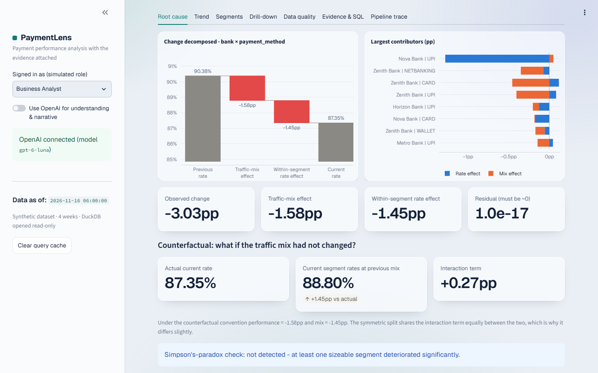
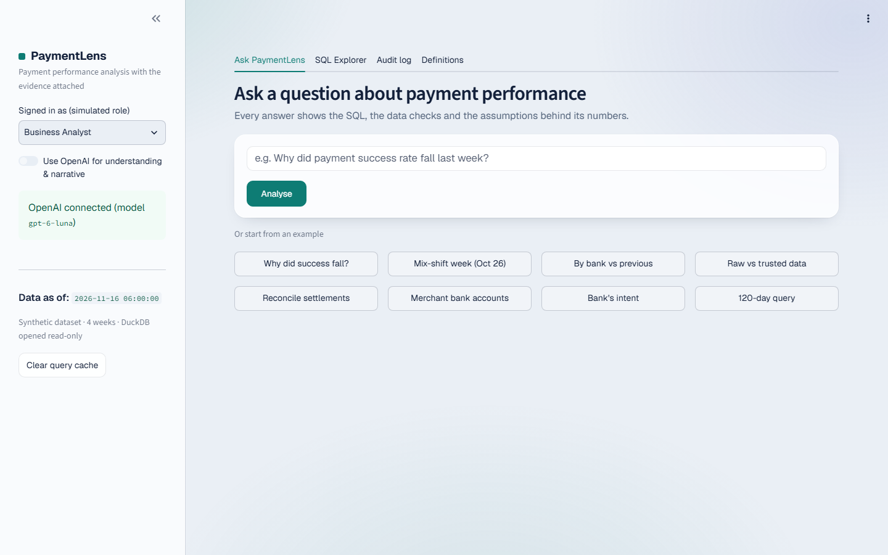
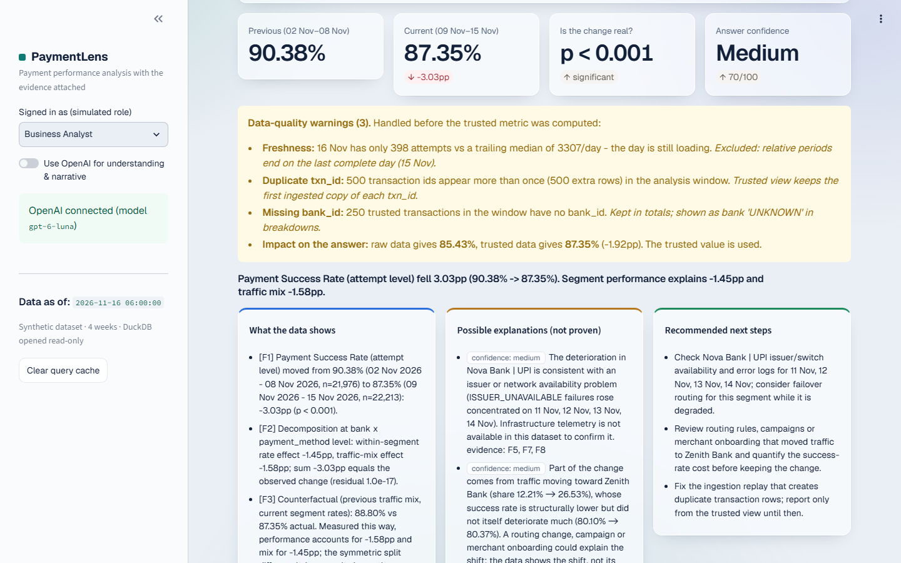
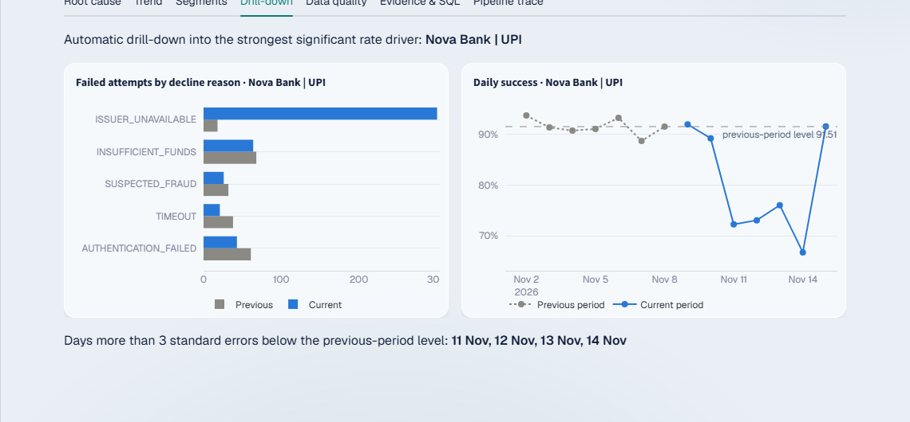
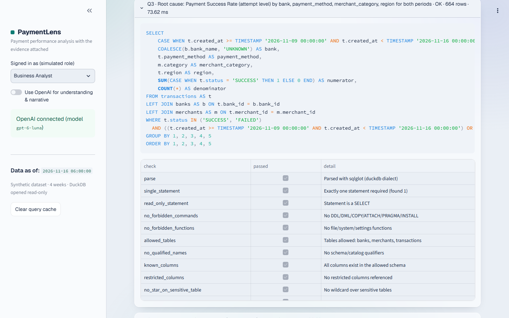
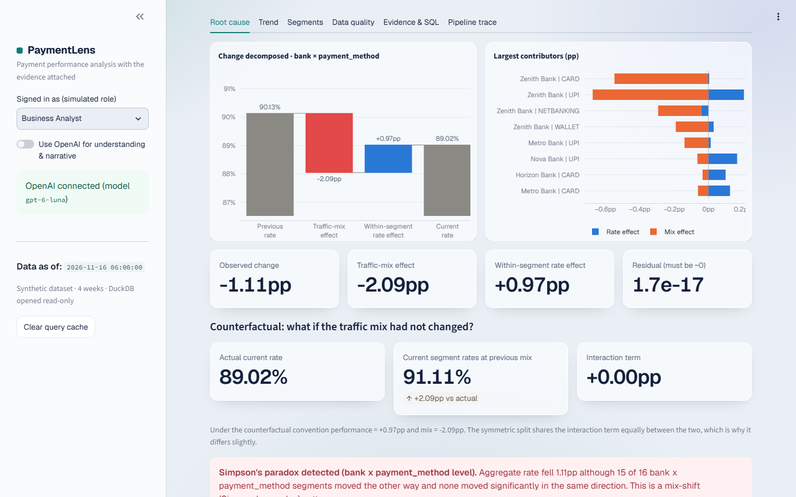
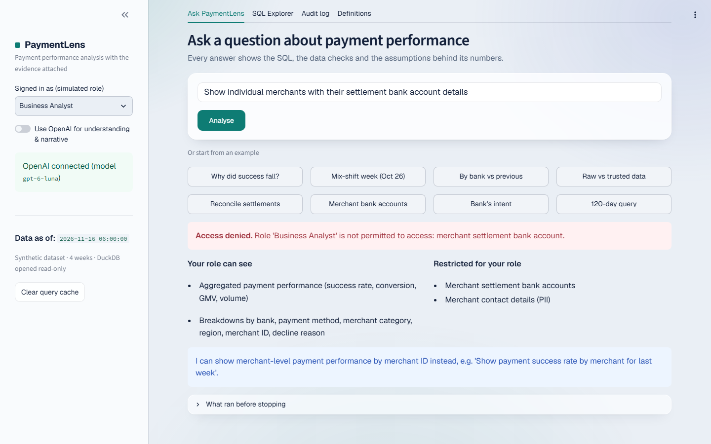
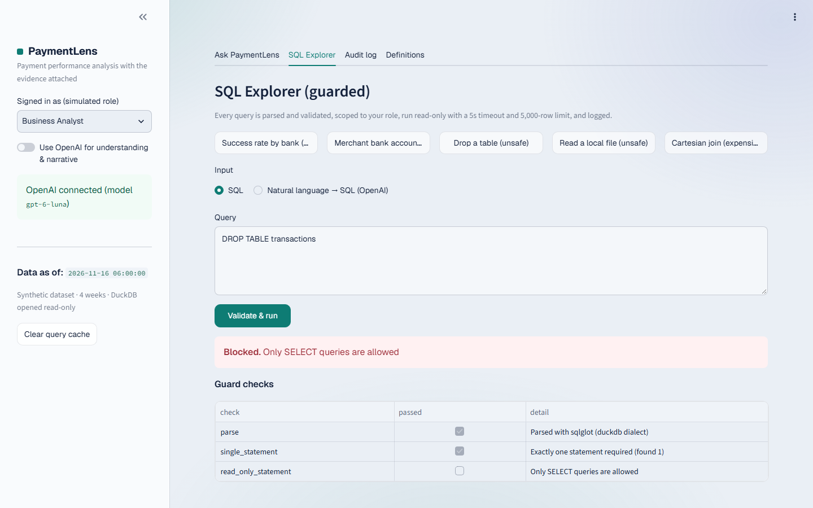
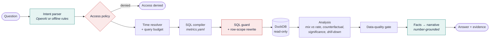

<div align="center">

# PaymentLens

**An AI analyst for payment performance that shows its evidence.**

Ask *"Why did payment success rate fall last week?"* in plain English. PaymentLens answers with the SQL, the maths,
the data-quality checks and the assumptions behind every number.


[**▶ Watch the 4-minute demo**](https://www.loom.com/share/4ad003b60ce543f392303aa1b6009c18) ·
[Quick start](#quick-start) ·
[How it works](#how-it-works) ·
[Testing](#testing-and-evaluation)

<a href="https://www.loom.com/share/4ad003b60ce543f392303aa1b6009c18">
  
</a>

</div>

---

## Why PaymentLens

Every payments team hears the same question: *why did our success rate go down?*

- An analyst needs **hours** to find the data, write SQL and explain it.
- A dashboard shows **what** changed, not **why**.
- A plain text-to-SQL chatbot can pick the **wrong formula**, use **dirty data**, run **unsafe SQL**, or **invent numbers**.

PaymentLens uses AI for only two jobs: **understanding the question** and **wording the answer**.
Everything in between is deterministic code that you can test and audit.

> **The AI is not the calculator, not the database authority and not the security layer.**

Built for **Challenge 2: Enterprise AI Business Analyst**.

---

## What it does

| | |
|---|---|
| **Understands the question** | Turns plain English into a structured request (metric, time window, comparison, filters). It uses OpenAI with a strict schema, and falls back to an offline parser if the AI is unavailable. |
| **Builds safe SQL** | SQL is compiled from a written metric dictionary, never typed by the AI. A guard checks every query, and it runs on a **read-only** database. |
| **Explains the change** | Splits a drop into **traffic-mix shift** and **real deterioration**, adds a what-if (counterfactual), runs significance tests and detects **Simpson's paradox**. |
| **Finds the cause** | Drills down automatically to the segment that got worse, its decline reasons and the bad days. |
| **Checks the data first** | Finds duplicates, missing IDs, invalid rows and half-loaded days, and shows how much each one changes the answer. |
| **Respects access** | Role-based rules deny restricted data, hide sensitive columns, and limit regional users to their own rows. |
| **Shows its proof** | Facts, possible explanations and next steps are kept separate. Every fact links to the query that produced it, and every decision is audited. |

### Example answer (synthetic data)

> **Payment success rate fell 3.03 pp (90.38% → 87.35%).**
> **1.58 pp** comes from traffic shifting to Zenith Bank, which always performs lower.
> **1.45 pp** is real deterioration, mainly **Nova Bank UPI**, where *issuer unavailable* failures rose from **18 to 301** on 11–14 Nov.
> At last week's traffic mix the rate would have been **88.80%**.
> The raw data also contained **500 duplicate rows**: without cleaning, the rate would have looked like **85.43%**.

---

## Screenshots

<table>
  <tr>
    <td width="50%"><br><sub><b>Ask in plain English.</b> Role switcher and AI toggle in the sidebar.</sub></td>
    <td width="50%"><br><sub><b>The answer.</b> Significance, data-quality impact, and facts kept separate from explanations.</sub></td>
  </tr>
  <tr>
    <td><br><sub><b>Automatic drill-down.</b> The deteriorating segment, its decline reasons and the bad days.</sub></td>
    <td><br><sub><b>Evidence.</b> The exact SQL behind each fact, with every safety check it passed.</sub></td>
  </tr>
  <tr>
    <td><br><sub><b>Simpson's paradox.</b> Every segment improved, yet the total fell. It's flagged as a pure mix effect.</sub></td>
    <td><br><sub><b>Access control.</b> Restricted data is denied before any SQL runs, with a safe alternative.</sub></td>
  </tr>
  <tr>
    <td colspan="2" align="center"><br><sub><b>SQL Explorer.</b> Free SQL goes through the same guard; <code>DROP TABLE</code> is blocked.</sub></td>
  </tr>
</table>

---

## How it works



- **Green steps use AI** and both have fallbacks. **Red steps enforce security.** Everything else is plain Python and SQL.
- **The AI never writes the analysis SQL.** It fills a closed schema (`AnalysisIntent`), and the compiler builds SQL from definitions in [`config/metrics.yaml`](config/metrics.yaml).
- **The AI's wording is checked.** If the narrative contains a number that doesn't appear in the computed facts, it is rejected and a template answer is shown instead.
- **The maths reconciles exactly.** Rate effect + mix effect = observed change (residual ≈ 1e-17).

---

## Quick start

**Requirements:** Python 3.11+ (developed on 3.13).

```bash
git clone https://github.com/demondragon07/PaymentLens.git
cd PaymentLens

python -m venv .venv
# Windows
.venv\Scripts\activate
# macOS / Linux
source .venv/bin/activate

pip install -r requirements.txt

python data/generate_data.py        # builds data/paymentlens.duckdb + data/ground_truth.json (seed 42)
streamlit run app.py                # opens http://localhost:8501
```

### Turn on AI mode (optional)

Copy `.env.example` to `.env` and add your key:

```env
OPENAI_API_KEY=sk-...
OPENAI_MODEL=gpt-4.1-mini          # any model that supports Structured Outputs
```

Without a key, everything still works offline: the rule-based parser and template narrative give the **same numbers**.

### Try these questions

| Question | What it shows |
|---|---|
| *Why did payment success rate fall last week?* | Full root cause: mix vs rate, counterfactual, drill-down |
| *Why did success rate fall in the week of Oct 26 compared with the week before?* | Simpson's paradox |
| *What was success rate last week using raw data?* | Data-quality impact (raw vs trusted) |
| *Reconcile last week's successful transactions with settlements* | Two sources disagree, gap explained exactly |
| *Show individual merchants with their settlement bank account details* | Access denied |
| *Did Zenith Bank intentionally reject our transactions?* | Refuses questions the data can't answer |
| *Show success rate for the last 120 days* | Blocked by the query budget |

---

## Roles and access

Roles are simulated with a sidebar switch (there is no login). They are defined in [`config/policies.yaml`](config/policies.yaml).

| | Admin | Business Analyst | Regional Analyst (North) |
|---|:---:|:---:|:---:|
| Aggregated performance and breakdowns | ✅ | ✅ | ✅ North only |
| Merchant settlement bank accounts | ✅ (SQL Explorer) | ❌ | ❌ |
| Merchant contact details (PII) | ✅ (SQL Explorer) | ❌ | ❌ |
| Other regions' data | ✅ | ✅ | ❌ |

Access is enforced in three places, none of which depends on the AI:
1. **Intent check:** restricted requests are denied before any SQL runs.
2. **SQL guard:** restricted columns are blocked, as is `SELECT *` on sensitive tables.
3. **Row-scope rewrite:** for scoped roles, every table is replaced with a filtered subquery.

## Safety

Every query, whether compiled by the app or typed in the SQL Explorer, goes through one governed path.

- **AST validation with sqlglot:**
  - single `SELECT` only;
  - no DDL or DML, and no `COPY`, `ATTACH`, `INSTALL` or `PRAGMA`;
  - no file, system or settings functions;
  - allowed tables and known columns only;
  - joins must have a condition.
- **Read-only DuckDB** with external access disabled and the configuration locked.
- **Query budget:** at most 90 days and 3 dimensions, plus a row limit and a 5-second timeout.
- **Result cache:** keyed by data version + SQL.
- **Audit log:** every decision is written to `logs/audit.jsonl` and shown in the app.

---

## Testing and evaluation

```bash
pytest                              # 48 tests
python scripts/run_eval.py          # 20 known-answer questions, offline parser
python scripts/run_eval.py --llm    # the same questions through OpenAI (needs a key)
```

The tests cover:
- the decomposition maths (hand-checked examples);
- SQL safety (17 malicious queries blocked) and role-based access;
- AI fallbacks and the number-grounding check;
- end-to-end answers compared with **ground truth computed independently** by the data generator.

| Known-answer evaluation | Offline parser | OpenAI |
|---|:---:|:---:|
| Cases passed | 20 / 20 | 20 / 20 |
| Intent accuracy | 14 / 14 | 14 / 14 |
| Numerical correctness | 11 / 11 | 11 / 11 |
| Driver identification | 4 / 4 | 4 / 4 |
| Policy enforcement | 4 / 4 | 4 / 4 |

The first OpenAI run scored 15/20. It exposed three integration bugs: the AI listed too many dimensions, returned no metric, and labelled a restricted request as unsupported. All three are fixed and covered by regression tests.

---

## Project structure

```
paymentlens/
├── app.py                     Streamlit UI
├── config/
│   ├── metrics.yaml           semantic layer: metrics, dimensions, joins, limits
│   └── policies.yaml          roles: restricted columns, row scope
├── core/                      pipeline orchestration, data models, time resolution
├── ai/                        OpenAI client, intent parser, offline parser, narrator, prompts
├── sqlengine/                 SQL compiler, guard, read-only executor, governed query service
├── analytics/                 decomposition, statistics, data quality, reconciliation, insights
├── security/                  access policy and audit log
├── data/generate_data.py      synthetic data with planted scenarios + independent ground truth
├── tests/                     48 tests + known-answer questions
├── scripts/                   evaluation, evidence capture, demo recording
└── docs/                      README screenshots and recorded run evidence
```

---

## Limitations

- **Synthetic data:** about 91k payment attempts over 4 weeks, with planted scenarios and anomalies. There are no real bank or provider integrations.
- **Simulated roles:** a sidebar switch, with no authentication or identity provider.
- **Contribution, not causation:** driver analysis shows the largest contributors, and explanations are labelled as hypotheses with a confidence level.
- **Fixed vocabulary:** only the configured metrics and dimensions are supported. Anything else is refused rather than guessed.
- **Heuristic cost control:** limits and a timeout, not an optimiser cost model.
- **Small evaluation set:** 20 questions. A larger set is the next step for measuring the AI's language coverage.

## Tech stack

Python · Streamlit · DuckDB · sqlglot · Pydantic · OpenAI Responses API (Structured Outputs) · pandas / NumPy / SciPy · Plotly · pytest
